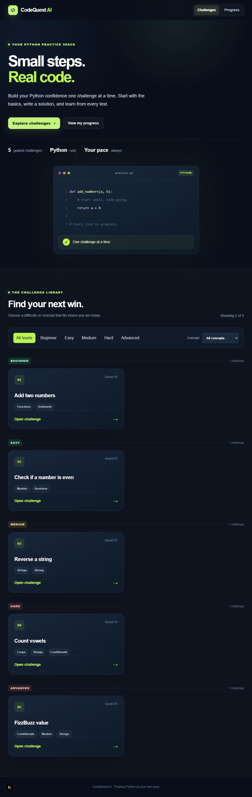
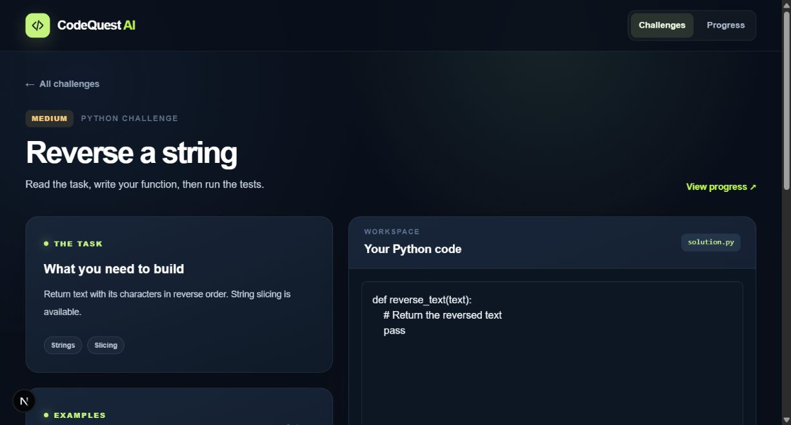
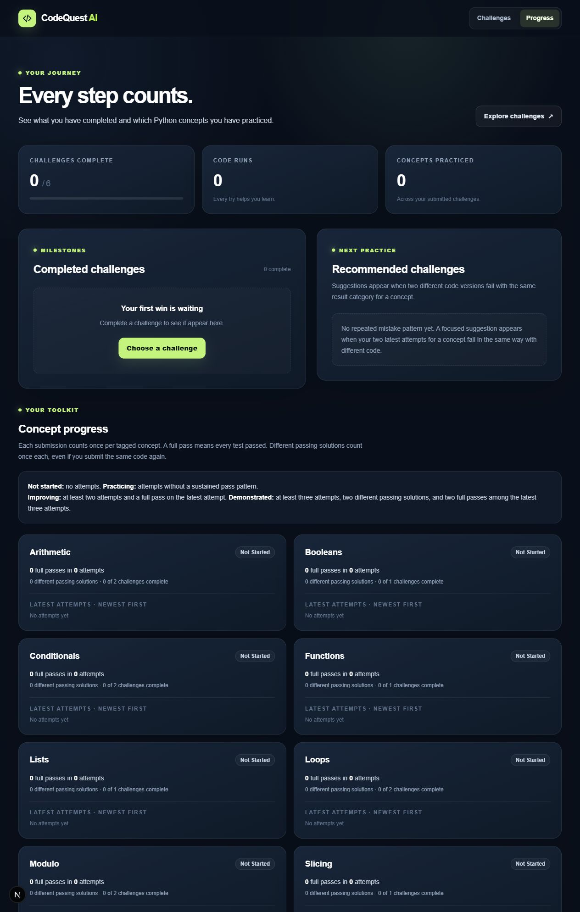
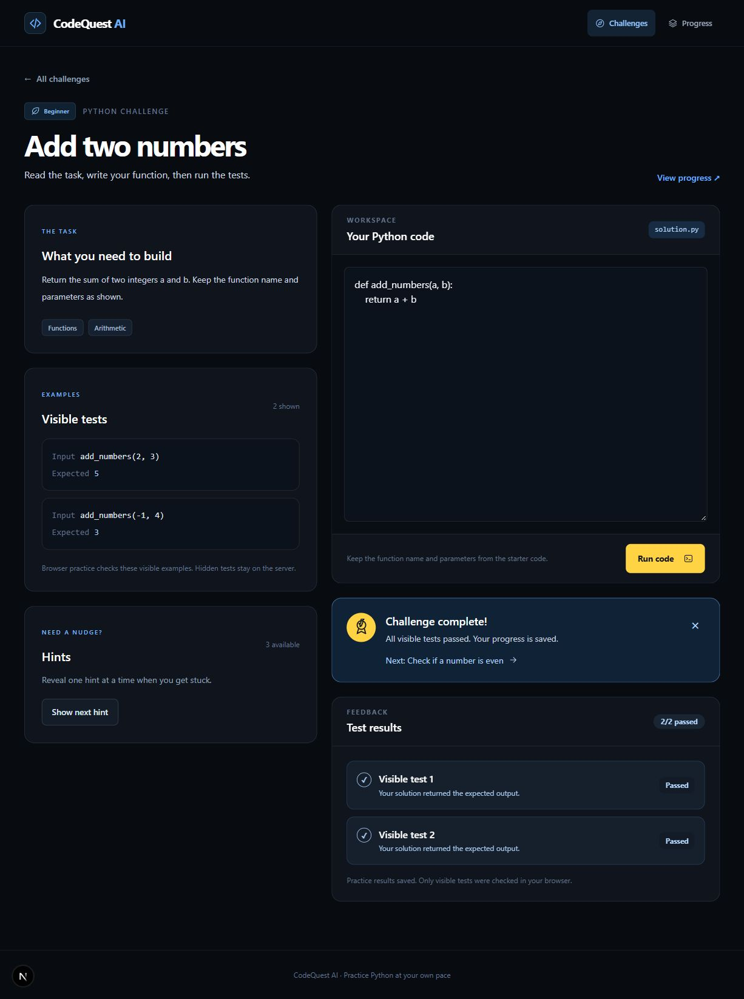

# CodeQuest AI 🚀

> **Small challenges. Big possibilities.**  
> Master Python through hands-on practice, AI-powered progressive hints, recurring mistake detection, and adaptive skill tracking. Built for curious beginners and problem solvers.

---

## 🌟 Key Features

### 1. 🧩 Clean Challenge Library & Editor
- **Progressive Difficulty Paths**: Beginner → Easy → Medium → Hard → Advanced.
- **Distraction-Free Starter Code**: Pure, clean function stubs (`def function_name(...):\n    pass`) without giveaway comments or pre-filled variables.
- **Intuitive In-Browser Editor**: Clean placeholder (`"Enter your code here"`) with instant syntax feedback.
- **Client-Side Python Engine**: Instant code execution via in-browser Pyodide for visible tests—no server lag or container dependencies required for daily practice.

### 2. 💡 Progressive Hints & Solution Leak Protection
- **Staged Guidance**: Each challenge features 3 progressive hints that become increasingly specific without revealing the final code.
- **Zero-Spoiler Guarantee**: Hints provide conceptual direction, algorithmic steps, or edge-case reminders—never full copy-paste solutions.

### 3. 🤖 Gemini AI Coding Mentor
- **Context-Aware Assistance**: Powered by Google Gemini (`gemini-flash-latest`), offering customized explanations tailored to the learner's specific question and code.
- **Unlocked On Demand**: Unlocks only after all hints have been explored, encouraging independent problem solving first.
- **AST Solution Safeguards**: Every mentor response is sanitized through strict code-checking rules to prevent the AI from revealing complete solutions.
- **Local Fallback**: Automatically switches to deterministic, rule-based hints if API quotas or keys are unavailable.

### 4. 🧠 Recurring Mistake Detection & Adaptive Learning
- **Intelligent Error Analysis**: Tracks errors across multiple attempts using AST inspection and test-case heuristics to detect recurring slip-ups:
  - **Off-by-one errors** (index slicing, `range()` bounds, loop termination conditions).
  - **Unhandled empty inputs** (empty strings `""`, empty lists `[]`, zero bounds).
  - **Missing returns, comparison precedence, and infinite recursion risks**.
- **Adaptive Recommendations**: The challenge catalog dynamically highlights and recommends targeted exercises designed to overcome identified weak spots.

### 5. 📊 Demonstrated Skills Tracking by Concept
- Tracks learner mastery across core programming concepts: `functions`, `strings`, `loops`, `lists`, `conditionals`, `booleans`, `modulo`, and `arithmetic`.
- **Mastery Levels**:
  - **Not Started**: No attempts yet.
  - **Practicing**: Active attempts in progress.
  - **Improving**: Full pass achieved on recent attempts.
  - **Demonstrated**: Consistent success across multiple distinct solutions.

---

## 🖼️ Previews

| Challenge Library | Practice & Hints |
| :---: | :---: |
|  |  |

| Progress & Skill Tracking | Level Celebrations |
| :---: | :---: |
|  |  |

---

## 🏗️ Architecture & Tech Stack

```text
├── frontend/                  # Next.js 16 (React 19, TypeScript, Tailwind CSS)
│   ├── src/app/               # App Router pages (challenges, login, progress)
│   ├── src/components/        # Reusable UI components & layout
│   └── src/lib/               # Supabase auth, Pyodide runner, typed API client
├── backend/                   # FastAPI (Python 3.11+, Pydantic v2)
│   ├── app/                   # API routes, Gemini mentor, mistake analyzer
│   ├── runner/                # Sandboxed Docker/Piston execution engines
│   └── tests/                 # Unit & integration test suites
└── supabase/                  # Database schema, catalog seed data, and RLS policies
```

- **Frontend**: Next.js 16 (App Router), React 19, Tailwind CSS, Pyodide (WebAssembly Python runner), Supabase Client.
- **Backend**: FastAPI, Uvicorn, Pydantic, Gemini API (`gemini-flash-latest`), Piston Runner / Docker sandbox.
- **Database & Auth**: Supabase (PostgreSQL with Row Level Security).

---

## 🚀 Local Development Setup

### Prerequisites
- Node.js 18+ & npm
- Python 3.11+
- *(Optional)* Docker or Piston (for server-side grading)

### 1. Backend Setup (FastAPI)
```powershell
cd backend
python -m venv .venv

# Windows:
.\.venv\Scripts\Activate.ps1
# macOS/Linux:
# source .venv/bin/activate

pip install -r requirements.txt
```

Create a `.env` file in `backend/` (or copy `.env.example`):
```env
CODEQUEST_STORAGE=supabase
SUPABASE_URL=https://<your-project>.supabase.co
SUPABASE_PUBLISHABLE_KEY=<your-publishable-key>
CORS_ORIGINS=http://localhost:3000
GEMINI_API_KEY=<your-gemini-api-key>
GEMINI_MODEL=gemini-flash-latest
CODEQUEST_RUNNER=piston
PISTON_URL=https://emkc.org/api/v2/piston
```

Start the backend server:
```powershell
uvicorn app.main:app --reload --port 8000
```
API documentation is available at `http://localhost:8000/docs`.

### 2. Frontend Setup (Next.js)
```powershell
cd frontend
npm install
```

Create a `.env.local` file in `frontend/`:
```env
NEXT_PUBLIC_SUPABASE_URL=https://<your-project>.supabase.co
NEXT_PUBLIC_SUPABASE_PUBLISHABLE_KEY=<your-publishable-key>
NEXT_PUBLIC_API_BASE_URL=http://localhost:8000
```

Start the frontend development server:
```powershell
npm run dev
```
Open [http://localhost:3000](http://localhost:3000) in your browser.

---

## 🌐 Deployment Guide

### Deploy Frontend on Vercel
1. Import the repository on [Vercel](https://vercel.com).
2. Set **Root Directory** to `frontend`.
3. Add the following **Environment Variables**:
   - `NEXT_PUBLIC_SUPABASE_URL`: Your Supabase URL.
   - `NEXT_PUBLIC_SUPABASE_PUBLISHABLE_KEY`: Your Supabase publishable key.
   - `NEXT_PUBLIC_API_BASE_URL`: Your deployed backend URL.
4. Click **Deploy**.

### Deploy Backend on Render
1. Create a **Web Service** on [Render](https://render.com) connected to this repository.
2. Configure settings:
   - **Root Directory**: `backend`
   - **Runtime**: `Python 3`
   - **Build Command**: `pip install -r requirements.txt`
   - **Start Command**: `uvicorn app.main:app --host 0.0.0.0 --port $PORT`
3. Add backend environment variables (`SUPABASE_URL`, `SUPABASE_PUBLISHABLE_KEY`, `GEMINI_API_KEY`, `PISTON_URL`, `CORS_ORIGINS=*`).
4. Click **Create Web Service**.

---

## 📡 API Reference

| Method | Endpoint | Description |
|---|---|---|
| `GET` | `/api/challenges` | List all challenges with lock status and adaptive recommendations |
| `GET` | `/api/challenges/{id}` | Retrieve clean starter code, description, and visible test cases |
| `POST` | `/api/challenges/{id}/hints/next` | Request next progressive hint (anti-spoiler protected) |
| `POST` | `/api/challenges/{id}/mentor` | Ask Gemini AI mentor for guidance (unlocked after hints) |
| `POST` | `/api/challenges/{id}/practice-attempts` | Save browser Pyodide practice attempt and test results |
| `POST` | `/api/challenges/{id}/attempts` | Submit solution for server-side evaluation (Piston/Docker) |
| `GET` | `/api/me/progress` | Get learner skill mastery, recurring mistakes, and recommendations |

---

## 🧪 Testing

Run backend tests:
```powershell
cd backend
python -m unittest discover -s tests -v
```

Run frontend typechecking and build:
```powershell
cd frontend
npm run typecheck
npm run build
```

---

## 📄 License
This project is licensed under the MIT License.
